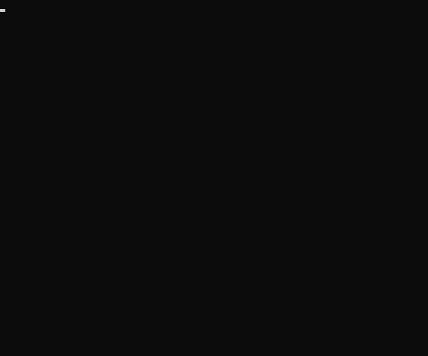
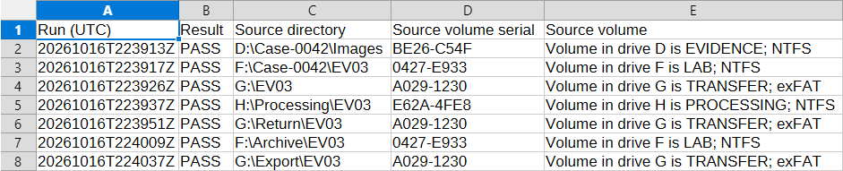
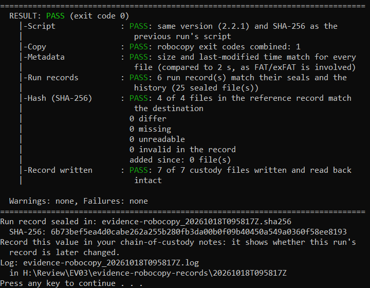
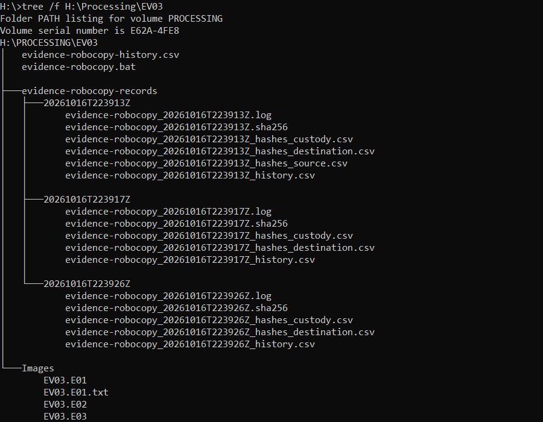
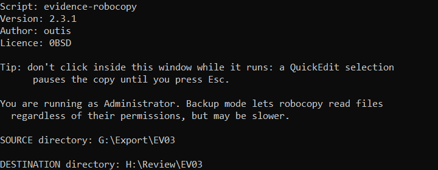

# evidence-robocopy

A Windows batch wrapper around robocopy for copying digital evidence between
drives as it moves around a lab (master to working copies, to servers, to
archive), with SHA-256 hash verification and chain-of-custody records.
Every copy is logged and verified by default, and a sealed record of it
stays with the evidence, together with the script itself.

Robocopy can be run many ways. This script fixes one documented methodology
for evidence, so every copy is made the same way and leaves a record that can
be audited, repeated and defended later.

It is a batch file on purpose: it uses only tools built into Windows and runs
wherever robocopy does, including workstations where PowerShell or `.ps1`
scripts are restricted, so it can travel with the evidence too.



A forensic copy to a USB drive, with the live display. The copy is sped up
ten times; the prompts, the checks and the result block play at real speed.

## What it does

- **Forensic by default.** Every run keeps a log, verifies every file and
  adds a sealed run record, without asking. `/nonforensic` is a separate
  plain copy utility for non-evidence copies (see below).
- **Evidence and custody files kept apart.** The evidence is copied as one
  directory, under its own name, into a *set directory*; beside it are the
  *custody files*: the script, the history and the records directory. Nothing
  is ever written into the evidence directory, and nothing is ever written to
  the source. See [Set and evidence directories](#set-and-evidence-directories).
- **SHA-256 verification against a reference record.** A first copy hashes
  the source and records it; that record is the reference for this and every
  later copy. Each copy hashes its destination with `certutil` and compares
  every file by relative path, so it is checked back to the original record,
  not only to its immediate source. Files that differ, are missing or are
  unreadable fail the run.
- **Verified from the drive, not from memory.** Every copy pass and the
  run's own record are written unbuffered (`robocopy /j`), so hashing reads
  file contents back from the destination drive rather than from the
  Windows cache.
- **Metadata check.** After the copy, robocopy compares every source file
  with its copy in list-only mode: any file whose size or last-modified
  time differs, or that wasn't copied, fails the run. Times are compared
  exactly, or to 2 s where FAT or exFAT or a network share is involved.
- **A sealed record of every copy, and a history.** Each run writes its
  log, hash CSVs and history into a run record of its own, sealed with
  their SHA-256s. On every copy, every earlier run record is checked against
  its seal and against the history. See [History and run
  records](#history-and-run-records).

  

  *The history in a spreadsheet: one row per copy (first five of 13 columns).*

- **Checks between copies.** A different script version, and a set that
  reached this drive by other means since the run that made it, are
  flagged. See [Checks between copies](#checks-between-copies).
- **Evidence counts are evidence only.** The custody files are copied in a
  pass of their own and hashed with their own counter into a separate CSV,
  so robocopy's totals, the hashing counters and the summary count evidence
  only, however many copies the set has been through.
- **A result that says what it covers**, with an exit code:

  | Result     | Exit code | Meaning |
  |------------|-----------|---------|
  | PASS       | 0         | The copy completed, every file in the reference record is in the destination with the same SHA-256, sizes and last-modified times match the source, and every earlier run record matches its seal and the history. |
  | FAIL       | 1         | The copy failed, a file in the reference record differs, is missing or unreadable, a file in the evidence directory isn't in the reference record, a file's size or last-modified time differs, a run record or the history doesn't check out, the script check failed, the run record couldn't be sealed or written back, or the run could not start. |
  | UNVERIFIED | 2         | `/nonforensic` only: copied without failures, verification declined. |

  The output is in sections named after the checks. The summary lists every
  warning and everything that failed the run, then ends with a result block:
  the verdict, each check in the order it ran (Script, Copy, Metadata, Run
  records, Hash) with a pointer to the section that explains anything not
  passed. On screen the block comes last, after the run record is written
  back, with a line for that write; PASS, WARN and FAIL are coloured where
  the console supports it (never in the log). Lines are kept within 80
  characters, except hashes and long paths. A file in the evidence
  directory that the reference record doesn't list (added since) fails the
  run: it is unexplained and not verified against anything.

  

  *The result block: the verdict and each check.*

- **Warnings up front.** Before copying, everything to be wary of is listed
  in one **Warnings** section at the top of the log header, and repeated in
  the summary: the machine may sleep or hibernate, or its power settings
  can't be read; the clock's last synchronisation is older than 7 days or
  isn't known, or its status can't be read; the destination is FAT32/FAT; a copy pass doesn't write unbuffered; a drive root holds fragments
  recovered by file-system repairs (`FOUND.nnn`, `LOST.DIR`; copied as
  contents); the source has no history, so the copy isn't checked against
  an earlier record; run records the Run records check will fail; a newer
  script than the previous run's; the set was moved or copied by other
  means; the console couldn't be switched to UTF-8. Links in the source
  that weren't copied are found after the copy, so they are listed with the
  summary's warnings.
- **Live display.** While a forensic run works, the console shows one
  block, redrawn in place: each check of the result block with its status
  or a progress bar, the file being copied (with robocopy's percentage
  within each large file) or hashed, and the last warnings and failures.
  Console only: the log and the records are written as before. Windows 10
  or later, not the legacy console; `EVIDENCE_ROBOCOPY_PLAIN=1` gives the
  plain output instead (robocopy's per-file lines, a line per hashed file),
  e.g. when the output is captured.
- **What is preserved.** Data, attributes and timestamps of files and
  subdirectories (`/copy:DAT /dcopy:DAT`), so anything hidden stays hidden;
  empty directories (`/e`). Junctions and symbolic links are not followed (`/xj`); each one not copied is listed as a warning. Exact byte sizes
  in the log (`/bytes`). When run elevated, backup mode (`/b`) reads files
  regardless of their permissions.
- **Owner and permissions are deliberately not copied:** copies inherit the
  destination's permissions, since the source's users and groups usually
  don't exist on the target system.
- **Drive roots.** When the source is a drive root (`E:\`), the
  housekeeping that Windows, macOS and Linux leave on drives they are
  plugged into is skipped: only the items actually present, by exact path,
  each listed in the log. Directories: `$RECYCLE.BIN`, `RECYCLER`, `RECYCLED`,
  `System Volume Information`, `.Trashes`, `.Spotlight-V100`, `.fseventsd`,
  `.TemporaryItems`, `.DocumentRevisions-V100`, `.Trash-*`. Files:
  `.DS_Store`, `._*`, `.apdisk`, `.VolumeIcon.icns`,
  `.com.apple.timemachine.donotpresent`, `.metadata_never_index*`,
  `Thumbs.db`, `.xdg-volume-info`, `.directory`. Inside directories and on UNC
  paths they are copied as contents.
- **Copying:** two evidence passes, both unbuffered (`/j`): files of 100 MiB
  or more single-threaded, smaller files with half the logical processors
  (1–128); then the custody files in a pass of their own. A pass with no
  file in its size class is skipped (the last pass always runs, so every
  directory is created). A failed file is retried once after 2 s, so real
  failures surface quickly; a file certutil can't read is hashed again
  once after 2 s before it is recorded as UNREADABLE.
- **Records are UTF-8** with CRLF line endings, and every CSV cell is
  quoted.

## Set and evidence directories

A **set directory** holds exactly one **evidence directory** and the **custody
files**: the script, `evidence-robocopy-history.csv` and
`evidence-robocopy-records\`. Set directories and the records directory may also
hold the files Explorer and macOS leave when browsing (`.DS_Store`, `._*`,
`.apdisk`, `desktop.ini`, `Thumbs.db`, `.directory`); they are ignored, not
copied or hashed. Inside the evidence directory they are evidence.



*A set: the evidence, the script, the history and a sealed record of each copy.*

**Source: which set is copied?**

| Rule | Source given | It is |
|------|--------------|-------|
| S1 | Enter | The script's own directory is the set directory (offered only when it holds exactly one evidence directory). |
| S2 | A directory holding the custody files | The set directory. |
| S3 | A directory whose parent holds them | That set's evidence directory; the parent is the set directory. |
| S4 | A directory with neither | Raw evidence: a first copy. |

A set directory that holds more than one directory besides the custody files, or
anything else unexpected, is refused, as is a directory that holds custody
files when its parent does too.

**Destination: where does the set go?** The destination must be an
existing directory. Names are compared exactly (ignoring case, as Windows
does). Two steps; junk names (`desktop.ini`, `.DS_Store` and the
like) never count as content.

1. Layout: the first rule that fits gives the set directory. The evidence
   directory's name is looked for before the destination's contents.

| Rule | Destination given | Set directory |
|------|-------------------|------------|
| D1 | Holds the custody files | The destination |
| D2 | Has the evidence directory's name, and its parent holds the custody files or nothing else | Its parent (the destination is the evidence directory) |
| D3 | Empty, or holds only a directory with the evidence directory's name | The destination |
| D4 | Anything else | A directory in it named after the set (made if it isn't there) |

   A directory inside a set that doesn't have its evidence directory's name is
   refused.

2. State, the same whichever rule applied: a set directory holding the custody
   files is the same set (a rerun or an update; its evidence directory must
   have the same name; confirmed before copying). Otherwise it is a new set,
   and it may hold nothing but an empty directory with the evidence directory's
   name. Anything else is refused.

A set directory made by D4 takes the source set directory's name; a first copy has
none, so it takes the evidence directory's name (a drive root's volume label,
or `Volume_<serial>` if it has none).

```
C:\Evidence\CASE18601\                      case directory (D4)
    CASE18601-EV03\                         set directory
        Images\                             evidence directory
        evidence-robocopy.bat
        evidence-robocopy-history.csv
        evidence-robocopy-records\
            20261014T160909Z\               run record
            20261015T091200Z\
```

## History and run records

Each run writes a **run record**, `evidence-robocopy-records\<run UTC>\`,
with every file named `evidence-robocopy_<run UTC>…`:

- `evidence-robocopy_<UTC>.log`: the warnings, then a header in three
  sections (environment: script version, path and SHA-256, host, user,
  Windows version, encoding, elevation, UTC start, local offset, time source
  and last sync, options; source: set and evidence directories, the rule that
  chose them, volume label, serial and file system, reference record,
  history, previous run, each housekeeping item skipped at a drive root;
  destination: the same, and this run's record), the robocopy output with
  exact byte sizes, problems as they are found, and the summary.
  Robocopy's Started/Ended and ERROR times are local; its per-file times
  are UTC.
- `evidence-robocopy_<UTC>_hashes_source.csv` (first copy only): the
  reference record. `…_hashes_destination.csv`: the evidence in the
  destination. Both list evidence only, `"File","SHA-256"`, one row per
  file, sorted by relative path within the evidence directory, so they can be
  compared row for row. A file that could not be hashed has `UNREADABLE` in
  place of a hash; zero-byte files get the SHA-256 of empty input
  (`certutil` can't hash them).
- `…_hashes_custody.csv`: the custody files in the destination set before
  this run's record was added (earlier run records, script copies, the
  history), same columns.
- `…_history.csv`: the history as this run left it (below).
- `…_runs_outside_history.csv` (only when this run restarted the history):
  the run records it found outside the history, with their seals' SHA-256.
- `evidence-robocopy_<UTC>.sha256`, the seal: one `<SHA-256> *<file name>`
  line for each of the above. Its own SHA-256 is shown at the end of the
  run, for the chain-of-custody notes. The script copy isn't listed: the
  sealed log records the script's SHA-256, which the copy is checked
  against.

**The history** has one row per run, newest last:

| Column | Content |
|--------|---------|
| Run (UTC) | the run record's name |
| Result | PASS or FAIL |
| Source directory | the source set directory, or for a first copy the evidence directory copied |
| Source volume serial, Source volume | volume serial number; label line and file system |
| Destination set directory | path |
| Destination volume serial, Destination volume | as for the source |
| Evidence files | files verified |
| Host, User | computer name; account name and SID |
| Script | name and version |
| Seal SHA-256 | that run's seal |

A run can't know its own seal's SHA-256 while writing its record, so in the
history sealed in a run record the newest row reads `see
evidence-robocopy_<UTC>.sha256`; the next run fills it in. The history
beside the evidence is a quick overview with every row filled in, rewritten
by every run. The columns are fixed for all of 2.x; cells never contain `"`
or `|`.

**Run records check**, on every copy, against the history this copy
continues:

- every run in the history has a run record, and its seal has the SHA-256
  the history records;
- every run record's own sealed history is the history up to that run;
- every file in a run record matches its seal, and the seal lists every
  file;
- no run record or file in the records directory is outside the history.

Any of these failing fails the run. The same checks run before copying,
on the set whose history the copy continues, every run record against its
seal included: anything they find is listed in the header's Warnings, so it
is seen before the copy starts; the result comes from the check of the
copies afterwards. A history row that doesn't name a run (a run's UTC time)
fails the check. The history beside the evidence is
checked against the run records before copying. If it is missing,
unreadable (e.g. saved by a spreadsheet) or doesn't match them, it is
disregarded and the copy continues from the newest sealed history (that of
the run record with the latest run UTC, taken as it is: no other is tried),
provided that one matches the run records: the copy fails, says so, and writes a
complete history beside the evidence again, so the next copy is clean. If
no sealed history matches either, the copy fails and continues from the
history beside the evidence as found, so the discrepancy stays visible; if
there is none, the history restarts with that run's FAIL row, that run
lists the run records it found outside the new history, and later copies
give a warning for each of them as long as it still matches the seal
SHA-256 listed for it. Removing the newest run record together with its
row leaves a consistent but shorter chain: only the seal SHA-256 recorded
in the custody notes shows it. A run record
left as `<UTC>.partial` (an interrupted write-back: each run record is
written under that name, read back by SHA-256 and only then renamed) is a
warning and outside the history.

A rerun into the same destination is a full run (robocopy copies what
differs; every file is verified) and gets its own row, e.g. run 3 FAIL,
run 4 PASS. A destination set whose history doesn't continue the source's
is refused before copying: sets are never mixed. If the source's history is
unusable but the destination's matches its run records, a rerun continues
the destination's history and the copy fails for the source's problem. The
history follows this copy's line of descent: copies branched off earlier
don't see each other.

An interrupted run leaves a partial copy and no run record in the
destination; its log stays in `%TEMP%` (header "Log during run"). A
destination holding a partial copy without custody files is refused: delete
the partial copy and run again. If the
run record can't be sealed completely or written at the end, the
destination gets the history the run continued, unchanged, the files stay
in `%TEMP%`, and the exit code is FAIL. The run's log
is sealed before that write, so a log left in the TEMP staging directory or
in a `<UTC>.partial` shows the verification result (e.g. PASS), not the
failed write; later copies warn about the `.partial`.

## Checks between copies

- **Script check** (its own line in the summary). The script is compared
  with the previous run's: the version from that run's sealed history, the
  SHA-256 from its sealed log. A newer version is a warning; an older
  version, or the same version with a different SHA-256, fails the run. The
  script never vouches for itself: a difference is flagged for the analyst
  to verify both scripts against the published release. The script copy
  beside the evidence comes by one route, decided before copying: the
  source set's copy with the same name if it is a newer version, otherwise
  the script that ran. A newer copy already in the destination is left as
  it is.
- **Location check.** The source set's volume serial and its path,
  ignoring the drive letter and case, are compared with where the run that
  made it copied it. A difference in either is a warning: the set reached
  this place by other means since (copied or moved without this script).

## Non-forensic mode

`/nonforensic` is a plain copy utility for non-evidence copies, confirmed
when chosen: it copies the source directory's contents into the destination
with ETA progress, keeps no log and writes no records, and treats custody
files and histories like any other file. It optionally verifies every file
by SHA-256 and metadata against its source, with the result on screen only.
A later forensic run on its output treats it like any other copy made
without the script.

## Requirements

- Windows with `robocopy` and `certutil` (both built in). Tested on
  Microsoft Windows 11 Pro 25H2. Copying directory attributes (`/dcopy:DAT`)
  needs a recent robocopy; Windows 7's only supports `/dcopy:T`. Older
  versions are untested.
- For the UTC time it uses robocopy's clock plus the registry time-zone bias
  (`ActiveTimeBias`), falling back to `wmic` where present. A forensic run
  stops if neither works.
- Administrator rights are optional; they enable backup mode and, on some
  systems, reading the file system of system volumes and the time-service
  status.
- The live display and the console colours need a console that takes VT
  sequences: Windows 10 or later, not the legacy console. Elsewhere the
  output is plain.

## Usage

```
evidence-robocopy.bat                 forensic mode (default)
evidence-robocopy.bat /nonforensic    plain copy utility, no log or records
evidence-robocopy.bat /?              help
```

Run as administrator for backup mode. Any other argument stops the run.
`EVIDENCE_ROBOCOPY_PLAIN=1` in the environment gives the plain console output
instead of the live display; `NO_COLOR=1` turns colour off. Neither changes
the log or the records.



*Source and destination, typed at the prompts.*

## Example

The third copy of a set, from its set directory (S2) into an empty
directory (D3). Header and summary of the log; the robocopy and per-file
lines are left out. Names, paths, host, user and serial are anonymised.

```
===============================================================================
Warnings (read before relying on this copy)
  none
  Findings made after the copy (such as links not copied) are in the summary.

Environment
  Script              : evidence-robocopy 2.3.0
  Script path         : C:\Tools\evidence-robocopy.bat
  Script SHA-256      : 9befc6ffffb467ec215dca8a229cea529606c57a06a5884d486d1acba352da77
  Mode                : forensic (default): log, SHA-256 verification and run
                         records
  Started (UTC)       : 2026-10-19T23:28:15Z (source: robocopy)
  Local UTC offset    : +01:00 (robocopy's Started/Ended and ERROR times are
                         local; its file times are UTC)
  Time source         : time.windows.com,0x9
  Last time sync      : 20/10/2026 00:27:38 (local time, as w32tm reports it),
                         38 s ago
  Host                : WORKSTATION-01
  User                : workstation-01\analyst (SID
                         S-1-5-21-1111111111-2222222222-3333333333-1001)
  OS                  : Microsoft Windows 11 Pro 25H2
  Encoding            : UTF-8 (code page 65001)
  Elevated            : yes (detected by fsutil), backup mode /b
  robocopy            : C:\Windows\System32\Robocopy.exe
  certutil            : C:\Windows\System32\certutil.exe
  Sleep when idle     : never, on mains or battery
  Excluded            : volume housekeeping at a drive root only (see Source)
  Retries             : 1 x 2 s
  Progress            : log file (/np /tee)
  Verify              : SHA-256 hash and metadata (size, last-modified time),
                         every file; run records against the history and their
                         seals
  Writes              : unbuffered (robocopy /j), evidence and custody records:
                         verification reads file contents from the drive

Source
  Set directory       : G:\EV03\
  Evidence directory  : G:\EV03\Images\
  Chosen              : S2: the directory holds the custody files: it is the
                         set directory
  Volume              : Volume in drive G is TRANSFER; serial 1A2B-3C4D; exFAT
  Skipped at root     : n/a (not a drive root)
  Reference record    : evidence-robocopy-records\20261019T232749Z\evidence-robocopy_20261019T232749Z_hashes_source.csv
                         (row 1 of the history)
  History             : 2 earlier run(s); this is run 3
  Previous run        : 20261019T232759Z (PASS, host WORKSTATION-01)
                        seal SHA-256:
    824d451507e22ac37504e0a09a330a134c5a07f370241642c9f06c1ba6c9d452

Destination
  Set directory       : H:\Processing\EV03\
  Evidence directory  : H:\Processing\EV03\Images\
  Chosen              : D3: the directory is empty or holds only a directory
                         with the evidence directory's name: it is the set
                         directory
  Was                 : new set (empty, or only an empty evidence directory)
  Volume              : Volume in drive H is PROCESSING; serial 5E6F-7A8B; NTFS
  Run record          : H:\Processing\EV03\evidence-robocopy-records\20261019T232815Z\
  Log                 : H:\Processing\EV03\evidence-robocopy-records\20261019T232815Z\evidence-robocopy_20261019T232815Z.log
  Log during run      : C:\Users\analyst\AppData\Local\Temp\evidence-robocopy_20261019T232815Z_16781_staging\records\evidence-robocopy_20261019T232815Z.log
===============================================================================

-------------------------------------------------------------------------------
Script: checked against the previous run
  Script              : PASS: same version (2.3.0) and SHA-256 as the previous
                         run's script

[...]

-------------------------------------------------------------------------------
Run records: against the history and their seals
Run record 20261019T232749Z: 5 file(s) match its seal, 0 problem(s).
  Seal SHA-256:
    a3e812f17acbe056f1361a99fb09fc5b4874c8ce73fd64012efdec51af81ea14
Run record 20261019T232759Z: 4 file(s) match its seal, 0 problem(s).
  Seal SHA-256:
    824d451507e22ac37504e0a09a330a134c5a07f370241642c9f06c1ba6c9d452

-------------------------------------------------------------------------------
Hash (SHA-256): hashing the destination

-------------------------------------------------------------------------------
Hash (SHA-256): destination vs reference record
  evidence-robocopy_20261019T232749Z_hashes_source.csv

-------------------------------------------------------------------------------
Summary
  Finished (UTC)      : 2026-10-19T23:28:31Z
  Script copy         : placed in the destination set directory as
                         evidence-robocopy.bat; its SHA-256 matches the Script
                         SHA-256 above
  Reference record    : evidence-robocopy_20261019T232749Z_hashes_source.csv
                        matches its seal
                         evidence-robocopy_20261019T232749Z.sha256
                        seal SHA-256:
    a3e812f17acbe056f1361a99fb09fc5b4874c8ce73fd64012efdec51af81ea14
  History             : run 3 (2 earlier run(s) in the history)
  Log                 : H:\Processing\EV03\evidence-robocopy-records\20261019T232815Z\evidence-robocopy_20261019T232815Z.log

  Warnings (did not fail the run)
    none

  Failures
    none

The copy completed, every file in the reference record is in the destination
  with the same SHA-256, and size and last-modified time match the source;
  every earlier run record matches its seal and the history

===============================================================================
  RESULT: PASS (exit code 0)
    |-Script              : PASS: same version (2.3.0) and SHA-256 as the
    |                        previous run's script
    |-Copy                : PASS: robocopy exit codes combined: 1
    |-Metadata            : PASS: size and last-modified time match for every
    |                        file (compared to 2 s, as FAT/exFAT is involved)
    |-Run records         : PASS: 2 run record(s) match their seals and the
    |                        history (9 sealed file(s))
    |-Hash (SHA-256)      : PASS: 4 of 4 files in the reference record match
    |                        the destination
    |                       0 differ
    |                       0 missing
    |                       0 unreadable
    |                       0 invalid in the record
    |                       added since: 0 file(s)

  Warnings: none, Failures: none
===============================================================================
```

## What the records prove

- Each run record shows what that run did and found: when (UTC, with the
  clock's source and sync state), on which host and under which account,
  with which script (its SHA-256), from where to where, robocopy's own
  output, and the SHA-256 of every evidence file. Its seal makes any later
  change to it detectable.
- Every copy is verified against the reference record made at the first
  copy, not only against the copy before it. Nothing before the first copy
  is covered: the reference record is not compared with an acquisition
  hash.
- The history shows the order of the runs and that no run record has been
  removed from it or added outside it. Each sealed history holds every
  earlier run's seal SHA-256, so the newest seal SHA-256 anchors the whole
  chain.
- A set is checked only when it is copied again; between copies nothing
  checks it.
- The seals are plain SHA-256 values, not signatures: they make a change
  detectable, not impossible. Someone with write access to the set and the
  script can build a new, consistent chain, or remove the newest run record
  together with its history row; only seal SHA-256 values recorded outside
  the set (e.g. in the custody notes) show either.
- A record can't show what happened after it was sealed: a write-back that
  failed afterwards is shown by the exit code, not by the log.
- The script never vouches for itself: the Script check flags a different
  or older script, but only the published release shows which one is
  genuine.
- Host, user and times are what that machine reported (`hostname`, the
  logon token, its clock).
- Outside the seals: junk names (`desktop.ini`, `Thumbs.db`, `.DS_Store`
  and the like) in the records directory, and `.partial` directories
  (interrupted write-backs: warned about, outside the history). A set
  copied by other means gets no history row; only the Location warning
  shows it.

## What it does not do

- Accept a source or destination path containing `%`: such paths are
  refused at the prompt (rename the directory or choose another). File and
  directory names inside the evidence may contain `%`.
- Replace chain-of-custody documentation: it records copies, not who held
  the media, why, seals or signatures.
- Verify an image against its acquisition hash.
- Protect its records from change: the seals only make changes detectable,
  once a seal's SHA-256 is recorded outside the evidence.
- Verify alternate data streams, empty directories, attributes or creation
  times. Robocopy copies them; only each file's main data stream is hashed,
  and only size and last-modified time are compared.
- Hash files that only backup mode can read. Robocopy copies them, but
  they are reported as unreadable (FAIL).
- Hash a file whose full path, on the source or on the destination, is
  longer than 4,000 characters: robocopy copies it, but cmd can't carry
  such a path, so the run fails and names the file by the first 200
  characters of its path. No mainstream system makes paths this long
  (Linux stops at 4,096 bytes, macOS at 1,024).
- Read its own custody files past 260 characters: a set directory whose
  path is longer than about 170 characters puts its run records and
  history beyond what cmd's tools open, and a copy from or to it fails
  (Run records FAIL), though the failure is named as a history mismatch.
  The evidence files inside the set are not affected. To be fixed in 2.3.1.
- Flush file-system metadata or a drive's own write cache: file contents
  are written unbuffered, but only ejecting or dismounting the drive
  flushes the rest.
- Recognise a mapped drive and its UNC path as the same place (in the
  check that source and destination don't overlap).
- Copy files named like DOS devices (`nul`, `aux` and the like) to a network
  (UNC) destination: Windows refuses to create them there, so the copy
  fails and reports them missing. They copy and verify on local drives.
- Keep the evidence directory's own timestamps as new: robocopy gives it the
  source directory's (`/dcopy:T`), and batch has no way to set them back.
- Read records made by 1.5.x and earlier: their first 2.0 copy starts a
  new reference record.
- Link a copy of a subdirectory to its parent set: the copy starts its own
  reference record.

Opening the CSVs in Excel can evaluate cells that start with `=`; open them
as text, imported as UTF-8. Seals have CRLF line endings: convert them before
`sha256sum -c`.

## Extending

Behaviour is set by tables in the CONFIG section at the top of the script,
each documented beside it, so most changes are a new row rather than code:

- `DRIVE_ROOT_HOUSEKEEPING_DIRS`, `DRIVE_ROOT_HOUSEKEEPING_FILES`:
  housekeeping skipped at a drive root, one row per origin (Windows, macOS,
  Linux).
- `DRIVE_ROOT_RECOVERED_DIRS`: drive-root directories that raise the
  recovered-fragments warning.
- `IGNORED_CUSTODY_FILES`: names ignored beside the evidence and in the
  records directory.
- `COPY_PASSES`, `PASS_<id>_*`: the robocopy passes (size split, threads,
  flags).
- `ROBOCOPY_EXIT_<bit>_*`: what each robocopy exit-code bit means and whether
  it fails the copy.
- `FILESYSTEM_WARNING_<file system>`: destination file systems that get a
  warning.
- `SLEEP_SETTINGS`: power settings read for the sleep advice.
- `CONTAINER_ATTRIBUTES`: attributes cleared from the destination evidence
  directory.
- `UTC_METHODS`, `ELEVATION_CHECKS`, `FILESYSTEM_METHODS`: ordered
  fallbacks; each name is a helper (`:utc_from_<name>`,
  `:elevation_check_<name>`, `:filesystem_from_<name>`).

The record layout, names and history columns are part of the 2.x contract:
later 2.x versions read every earlier 2.x record and only add information
as new files in run records; the history's columns never change in 2.x.

The script header lists the terms and the conventions for contributors:
naming, paths with special characters, what goes to the console and what to
the log.

## Licence

0BSD. See [LICENSE](LICENSE).
